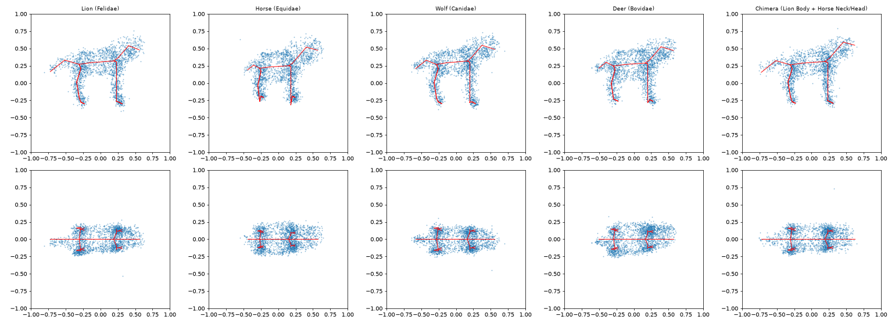

# 3D Creature Generation via Skeleton-Conditioned Optimal Transport Flow Matching

[](https://www.python.org/downloads/)
[](https://pytorch.org/)
[](https://threejs.org/)
[](https://opensource.org/licenses/MIT)

Projet de recherche et portfolio en Deep Learning géométrique 3D : génération de nuages de points de quadrupèdes conditionnée par un squelette cinématique ($K=35$ articulations), et synthèse d'hybrides chimériques par greffe de sous-arbres du squelette. Le modèle génératif est un **Flow Matching à chemins de transport optimal conditionnel (OT-FM)** avec un backbone **Point-DiT**.



*Nuages de 2048 points générés en 20 pas de Heun à partir du squelette seul (en rouge). La dernière colonne est une chimère : corps de lion, cou et tête d'équidé.*

---

## 🌟 Points Forts du Projet

- **Optimal Transport Flow Matching** : chemins linéaires $x_t = (1-t)x_0 + t x_1$ entre le bruit gaussien et la surface de la créature, échantillonnage en 15 à 20 pas d'ODE.
- **Point-DiT** : modulation temporelle AdaLN-Zero, self-attention sur les points, et **cross-attention spatiale points $\to$ squelette** avec un biais de distance multi-échelle (voir [Conditionnement par le squelette](#-conditionnement-par-le-squelette)).
- **Squelette cinématique à 35 articulations inspiré de SMAL**, pour 5 familles : félins, canidés, équidés, bovidés, hippopotamidés.
- **Greffe cinématique d'hybrides** : un sous-arbre du squelette donneur (par ex. cou et tête) est recollé sur l'hôte au niveau de l'articulation de jonction.
- **Visionneuse Web 3D (Three.js)** : inspection des nuages de points et du squelette, et animation du flux $t = 0 \to 1$.
- **100 % PyTorch** : pas d'extension C++/CUDA à compiler (ni PyTorch3D ni DGL).

---

## 📐 Formulation Mathématique

### 1. Interpolation par Transport Optimal
Pour $x_0 \sim \mathcal{N}(0, I)$ et $x_1 \sim p_{\text{data}}(x \mid S)$ :
$$x_t = (1 - t) x_0 + t x_1, \quad t \in [0, 1]$$
$$u_t(x_t \mid x_0, x_1) = \frac{dx_t}{dt} = x_1 - x_0$$

Le couplage entre $x_0$ et $x_1$ est indépendant (chemin OT *conditionnel*, au sens de Lipman et al., 2023) ; il n'y a pas de couplage OT par mini-batch.

### 2. Objectif d'Apprentissage
$$\mathcal{L}_{\text{FM}}(\theta) = \mathbb{E}_{t, x_0, (x_1, S)} \left[ \| v_\theta(x_t, t, S) - (x_1 - x_0) \|^2 \right]$$

Le réseau traite les points comme un ensemble (équivariance par permutation) : il ne peut apprendre que le champ de vitesse marginal, dont la variance est irréductible. La loss plafonne donc autour de 0.3 même quand le modèle reproduit bien les formes ; la Chamfer Distance est le critère pertinent.

### 3. Solveurs ODE d'Inférence
- **Euler** : $x_{t + \Delta t} = x_t + \Delta t \cdot v_\theta(x_t, t, S)$
- **Heun (ordre 2)** : prédiction-correction, utilisé par défaut.

---

## 🦴 Conditionnement par le Squelette

Chaque point interroge les 35 articulations encodées par un Transformer sur le squelette. Le score d'attention de la tête $h$ reçoit un biais de distance :

$$\text{score}_{h}(i, k) = \frac{q_i \cdot k_k}{\sqrt{d}} - \lambda_h \, \| \hat{x}_{1,i} - J_k \|^2, \qquad \lambda_h = \lambda_0 \cdot 2^h$$

- **Multi-échelle** : avec $\lambda_0 = 2$ (`spatial_distance_scale` dans la config), les 8 têtes couvrent des échelles de 2 à 256, de l'attention presque globale à l'attention très locale. Les $\lambda_h$ sont paramétrés en log et apprenables, mais en pratique ils restent proches de leur initialisation.
- **Estimation de la forme finale** : la distance est calculée sur une estimation $\hat{x}_1 = x_t + (1-t)\,\hat{v}$ affinée après chaque bloc par une tête linéaire initialisée à zéro, plutôt que sur $x_t$, qui n'est que du bruit au début de la trajectoire.

---

## 📊 Résultats

Modèle de 10,4 M de paramètres entraîné 30 époques sur 500 créatures (100 par famille), soit environ 16 min sur une RTX 4060 Laptop (pic mémoire de 5,6 Go).

**Protocole** (`scripts/evaluate_families.py`) : 40 squelettes jamais vus (8 par famille, seed disjointe de l'entraînement). Chaque créature générée est attribuée à la famille dont les 8 formes réelles de référence sont en moyenne les plus proches en Chamfer Distance.

| Variante | Biais de distance | Position utilisée | Famille reconnue | CD vers sa famille |
|---|---|---|---|---|
| Biais fixe (version initiale) | $\lambda = 1.5$ | $x_t$ | 16/40 (40 %) | 0.0060 |
| Estimation $\hat{x}_1$ seule | $\lambda = 1.5$ | $\hat{x}_1$ | 10/40 (25 %) | 0.0076 |
| Multi-échelle seul | $2 \to 256$ | $x_t$ | 31/40 (78 %) | 0.0031 |
| **Modèle final** | $2 \to 256$ | $\hat{x}_1$ | **37/40 (92 %)** | **0.0029** |

À titre de repère, la Chamfer Distance entre deux créatures réelles d'une même famille va de 0.0005 à 0.0012 (0.0007 en moyenne), et celle d'un modèle non entraîné d'environ 1.9.

**Lecture de l'ablation** : le biais multi-échelle explique l'essentiel du gain. Avec un $\lambda$ unique et faible, le biais est presque plat à l'échelle des créatures et le modèle produit un « quadrupède moyen ». L'estimation $\hat{x}_1$ n'apporte rien seule, et le gain qu'elle semble ajouter au multi-échelle (de 78 % à 92 %) repose sur un seul entraînement par variante : c'est plausible, pas démontré.

---

## ⚠️ Limites

- **Données procédurales, pas SMAL** : les formes sont des cylindres échantillonnés autour d'un squelette paramétrique inspiré de la topologie SMAL, pas le modèle SMAL lui-même (`shape_betas` est inutilisé). La variabilité intra-famille est faible (±3 % sur les proportions).
- **Bovidés** : reconnus à 5/8 seulement, confondus avec les équidés, dont les proportions de squelette sont proches.
- **Précision** : les formes générées restent environ 4 fois plus éloignées de leur famille que deux créatures réelles entre elles (0.0029 contre 0.0007).
- **Greffe** : la jonction aligne le sous-arbre donneur par translation, sans mise à l'échelle ni rotation.
- **Une seule seed par variante** dans l'ablation (bruit d'environ ±7 points de pourcentage sur 40 exemples).

---

## 📁 Architecture du Répertoire

```text
3D_Creation/
├── configs/
│   └── default_config.yaml       # Hyperparamètres (modèle, entraînement, dataset)
├── data/
│   ├── smal_quadrupeds.py        # Hiérarchie 35 joints & générateur procédural de surfaces
│   └── dataset.py                # Dataset PyTorch, cache versionné & augmentations
├── models/
│   ├── point_dit.py              # Point-DiT, AdaLN-Zero, cross-attention spatiale multi-échelle
│   ├── skeleton_encoder.py       # Encodeur Transformer du squelette
│   └── flow_matching.py          # OT-Flow Matching & solveurs ODE (Euler / Heun)
├── pipeline/
│   ├── hybrid_splicer.py         # Greffe de sous-arbres pour les chimères
│   ├── metrics.py                # Chamfer Distance, couverture du squelette, nouveauté
│   └── trainer.py                # Boucle d'entraînement CPU/GPU
├── viewer/
│   ├── index.html                # Visionneuse 3D HTML5
│   ├── app.js                    # Contrôles Three.js (caméra, curseur t, rendu)
│   ├── style.css                 # Interface sombre
│   └── data/                     # Trajectoires exportées (creatures.json)
├── scripts/
│   ├── prepare_data.py           # Génération et mise en cache du dataset
│   ├── train.py                  # Entraînement
│   ├── sample_and_export.py      # Génération de trajectoires & export JSON pour la visionneuse
│   ├── evaluate.py               # Chamfer Distance & couverture du squelette
│   └── evaluate_families.py      # Reconnaissance de famille & matrice de confusion
├── tests/                        # Tests unitaires et test d'overfit (pytest)
├── docs/                         # Spécifications, plans et images
├── requirements.txt
└── README.md
```

---

## 🚀 Guide de Démarrage Rapide

### 1. Installation de l'environnement
```bash
python -m venv .venv
# Linux/macOS : source .venv/bin/activate   —   Windows : .venv\Scripts\activate
pip install torch --index-url https://download.pytorch.org/whl/cu128   # GPU NVIDIA ; omettre --index-url pour la version CPU
pip install -r requirements.txt
```

### 2. Exécution des tests
```bash
pytest tests/ -v
```
`tests/test_overfit.py` vérifie que le modèle apprend réellement une créature (environ 10 s sur CPU).

### 3. Génération du dataset
```bash
python scripts/prepare_data.py --config configs/default_config.yaml
```

### 4. Entraînement
```bash
python scripts/train.py --config configs/default_config.yaml
```

### 5. Évaluation
```bash
python scripts/evaluate.py
python scripts/evaluate_families.py
```

### 6. Export des créatures pour la visionneuse
```bash
python scripts/sample_and_export.py
```

### 7. Lancement de la visionneuse 3D
```bash
python -m http.server 8000 --directory viewer
```
Puis ouvrez `http://localhost:8000`. La caméra se manipule à la souris, et le curseur temporel $t \in [0, 1]$ montre la créature émerger du bruit gaussien.
