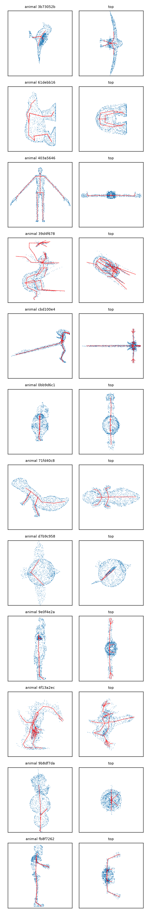
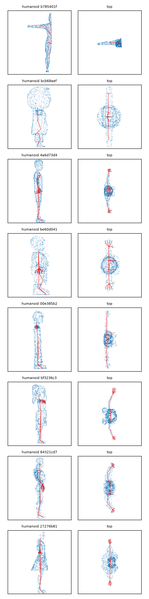
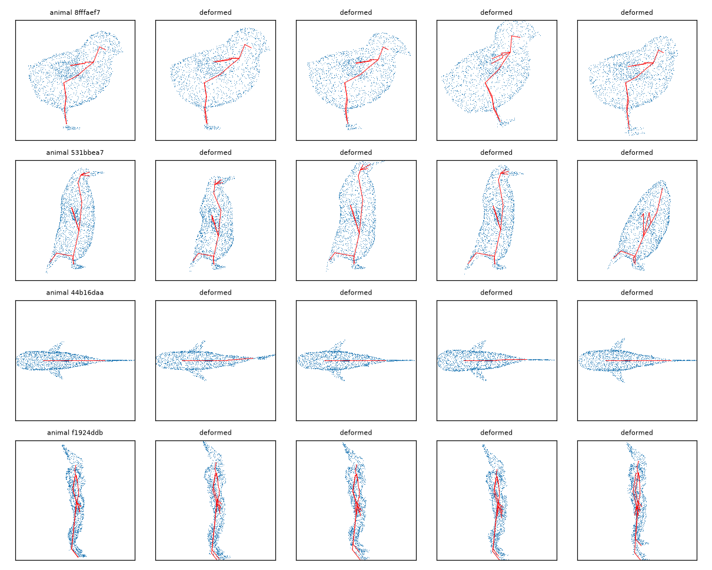

# Données Articulation-XL : rapport de construction

## train

- Fragments : 729, taille 4.77 Go
- Modèles retenus : 40218 (humanoid 29270, animal 10948)
- Rejets : 6420 (excluded category 6420)
- Orientation décidée par : lateral 35913, geometry 3515, head 790

| Tag | Modèles retenus |
|---|---|
| character | 25534 |
| anthropomorphic | 16662 |
| mythical creature | 5934 |
| animal | 5433 |
| toy | 2328 |
| weapon | 890 |
| scanned data | 858 |
| clothing | 194 |
| sculpture | 150 |
| anatomy | 133 |
| tool | 114 |
| accessory | 113 |
| food | 109 |
| electronic device | 87 |
| plant | 87 |
| vehicle | 42 |
| miscellaneous | 37 |
| humanoid | 31 |
| furniture | 27 |
| sporting goods | 18 |
| musical instrument | 8 |
| architecture | 8 |
| human | 7 |
| armor | 6 |
| anatomical | 6 |
| mythological creature | 6 |
| household item | 4 |
| vegetable | 2 |
| Character | 2 |
| architectural | 2 |
| characters | 2 |
| robot | 2 |
| planet | 1 |
| fantasy creature | 1 |
| sculptural | 1 |
| insect | 1 |
| accessories | 1 |
| mythology | 1 |
| anatomically | 1 |
| mechanical device | 1 |
| anthropology | 1 |
| mythological | 1 |
| robotic | 1 |
| electronics device | 1 |
| paper | 1 |
| Animal | 1 |
| mythology creature | 1 |

| Articulations | Modèles |
|---|---|
| 2–9 | 1934 |
| 10–19 | 3942 |
| 20–29 | 10416 |
| 30–39 | 5373 |
| 40–59 | 15643 |
| 60–79 | 2420 |
| 80–119 | 490 |
| 120–255 | 0 |

## test

- Fragments : 32, taille 0.21 Go
- Modèles retenus : 1736 (humanoid 1242, animal 494)
- Rejets : 261 (excluded category 261)
- Orientation décidée par : lateral 1529, geometry 172, head 35

| Tag | Modèles retenus |
|---|---|
| character | 1046 |
| anthropomorphic | 820 |
| mythical creature | 259 |
| animal | 254 |
| toy | 97 |
| scanned data | 35 |
| weapon | 30 |
| electronic device | 9 |
| tool | 9 |
| sculpture | 9 |
| clothing | 7 |
| anatomy | 6 |
| food | 5 |
| accessory | 5 |
| plant | 3 |
| miscellaneous | 3 |
| sporting goods | 2 |
| humanoid | 2 |
| human | 1 |
| architecture | 1 |
| Anthropomorphic | 1 |

| Articulations | Modèles |
|---|---|
| 2–9 | 94 |
| 10–19 | 169 |
| 20–29 | 492 |
| 30–39 | 223 |
| 40–59 | 627 |
| 60–79 | 109 |
| 80–119 | 22 |
| 120–255 | 0 |

## Planches

Audit d'orientation : 200 créatures sur 10 pages (`audit_*.png`, non commitées).

## Audit d'orientation (200 créatures d'entraînement tirées au hasard, inspectées à l'œil)

| Résultat | Créatures | Part |
|---|---|---|
| Haut et profil corrects | 175 | 87,5 % |
| Haut faux (créature couchée ou en diagonale) : #1, #20, #28, #39, #57, #70, #108, #157 | 8 | 4 % |
| Vue de face au lieu de profil (avant à 90°) : #15, #113, #137, #169 | 4 | 2 % |
| Ambigus (objets, formes sans haut lisible) : #4, #23, #43, #79, #111, #134, #146, #153, #164, #168, #171, #180, #199 | 13 | 6,5 % |

Échecs nets : 6 % (12,5 % au pire si tous les cas ambigus sont faux), sous le seuil de 10 % fixé par le plan. Les échecs se concentrent sur des modèles dont la pose d'origine n'est pas debout (personnages couchés) et sur des poses en T vues de face, où la règle gauche/droite se trompe de 90°. **Limite** : les planches ne marquent pas la tête, donc le sens avant/arrière (+X contre −X) n'a pas été vérifié ; l'augmentation par rotation autour de Y de l'étape 2 rend ce point moins critique.
